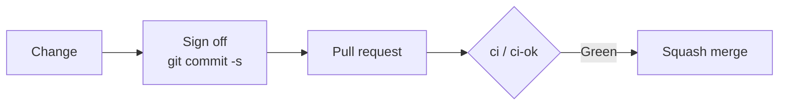

# Contributing

| Change | How |
| --- | --- |
| A rule in the method | Edit [plugin/skills/craft-site/SKILL.md](plugin/skills/craft-site/SKILL.md). Say in the pull request which site proved the rule, and how it was measured |
| A skill | Add `plugin/skills/<name>/SKILL.md` with front matter whose `name` is the folder's. Run `python3 -I tools/check_plugin.py` |
| A figure | Attribute it in its sentence, with the source and the date you read it, or label it a goal |
| Writing | One idea per sentence, under about 30 words, no em dashes. `bash tools/voice_lint.sh` runs the lint CI runs |
| Every commit | Sign off with `git commit -s` ([DCO](https://developercertificate.org/)) |
| Every pull request | `ci / ci-ok` must pass. It runs the plugin check and its self-test, and the voice lint |
| Names and art | Never add the SoulCraft name, characters or art to a starter ([NOTICE](NOTICE)). Never add a secret, a private path or personal data |
| A question | Open an issue. A security or conduct problem goes to the private form in [SECURITY.md](SECURITY.md) |

Every contributor keeps the [code of conduct](CODE_OF_CONDUCT.md).
