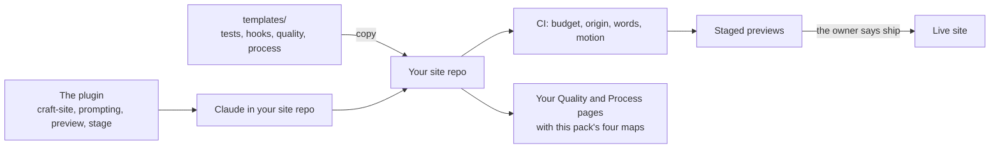

# Website Crafter

Craft your own website with Claude. A plugin teaches Claude the method; starters give your site its page tests, its guard hooks and its Quality and Process pages. Published by [SoulCraft-Org](https://github.com/SoulCraft-Org) under [Apache-2.0](LICENSE).



## Start in three steps

| Step | Do |
| --- | --- |
| 1 Install | Add the marketplace and install the plugin, with the two commands below |
| 2 Copy | Into your site repo: [templates/tests](templates/tests/README.md) to `tests/e2e/`, [templates/hooks](templates/hooks/README.md) to `.claude/hooks/`, [templates/quality](templates/quality/README.md) to `quality/` and [templates/process](templates/process/README.md) to `quality/process/`. Each README says what to edit |
| 3 Craft | Ask Claude to plan a page with the craft-site skill: its role, its one signature move, then the build. When it is ready, say "stage this" |

```bash
claude plugin marketplace add SoulCraft-Org/website-crafter
```

```bash
claude plugin install website-crafter@website-crafter
```

## What is in the box

| Part | Gives your site |
| --- | --- |
| [craft-site](plugin/skills/craft-site/SKILL.md) | The method: one role and one signature move per page, a start-up budget, same-origin pages, motion a pause stills, a words lint, stage before ship |
| [prompt-fibo](plugin/skills/prompt-fibo/SKILL.md), [prompt-ltx](plugin/skills/prompt-ltx/SKILL.md), [prompt-meshy](plugin/skills/prompt-meshy/SKILL.md) | Prompting FIBO 2.0 for pictures, LTX-2.5 for video and Meshy for 3D. Your site fills in each one's style block |
| [site-preview](plugin/skills/site-preview/SKILL.md), [stage](plugin/skills/stage/SKILL.md) | A page-by-page review of the built site, then private previews for the owner and the ship |
| [templates/tests](templates/tests/README.md) | Four Playwright tests: the start-up budget, same-origin requests, pausable motion and the words lint |
| [templates/hooks](templates/hooks/README.md) | Three guard hooks: no hand edits to generated files, staging by path, and a yes before every deploy |
| [templates/quality](templates/quality/README.md), [templates/process](templates/process/README.md) | Your Quality, Speed and Consumption page and your Process page, built by Git Crafter |
| [maps/](maps/README.md) and [pack.json](pack.json) | Four Process maps the quality starter pins: media, stage, reveal and open |
| [page-roles](templates/page-roles.md), [art-record](templates/art-record.md), [pull-request](templates/pull-request.md) | One row per page role, one row per asset, and the pull request a site change opens |
| [tools/export_public.py](tools/export_public.py) | Copies a private site's allow-listed files into a fresh public repo, or nothing when one holds an email, a home path or a key |

CI checks this repo on every pull request: the plugin manifests and each skill's front matter, the voice lint, and the starters against Git Crafter's engine. It also runs the guards' and the export tool's self-tests, and the page tests on a good and a bad fixture site.

## Related

| Repo | Use |
| --- | --- |
| [SoulCraft-Org/git-crafter](https://github.com/SoulCraft-Org/git-crafter) | The CI standard this repo runs on, and the engine behind the Quality and Process pages |
| [SoulCraft-Org/compute-crafter](https://github.com/SoulCraft-Org/compute-crafter) | Free tiers and included credits for the compute a site needs |

The SoulCraft name and art are not part of the licence ([NOTICE](NOTICE)). [Contributing](CONTRIBUTING.md), [Security](SECURITY.md) and the [Code of conduct](CODE_OF_CONDUCT.md) say how to take part.
