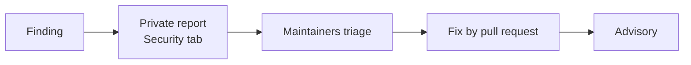

# Security

Website Crafter is licensed under [Apache-2.0](LICENSE) and published by SoulCraft-Org. Report a security problem privately, never in a public issue.

| Step | How |
| --- | --- |
| Report | GitHub private vulnerability reporting: [Report a vulnerability](https://github.com/SoulCraft-Org/website-crafter/security/advisories/new) |
| Never | open a public issue for a security problem, or paste a key value anywhere |
| Then | the fix lands by pull request, and the advisory names the reporter unless they ask otherwise |
| Conduct | A conduct problem uses the same private form: see [CODE_OF_CONDUCT.md](CODE_OF_CONDUCT.md) |

| In scope | A finding looks like |
| --- | --- |
| `plugin/skills/` | A step that prints, stores or passes a key value, or deploys without the owner's yes |
| A starter | A file that would commit a secret, a private path or personal data into the site that copies it |
| `tools/` | A check that passes a manifest it should refuse, or runs code it fetched from an unpinned ref |
| `.github/workflows/` | A step that runs untrusted input, or an unpinned action |
