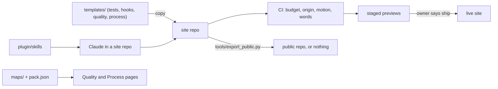

# website-crafter spec

Website Crafter is a Claude Code plugin plus starters. The plugin teaches Claude to craft a fast, quiet website. The starters give a site repo its page tests, guard hooks, and Quality and Process pages.

| Row | Spec |
|---|---|
| Purpose | The method (one role and one signature move per page, start-up budget, same-origin pages, pausable motion, words lint, stage before ship) as a plugin, with starters a site repo copies (`README.md`) |
| Inputs | A site repo's built pages (for the page tests), `templates/*/config.json` and `guards.json` (a site's own data), `maps/*.json`, and for the export tool a private site's tracked files and `tools/export_rules.json` |
| Outputs | An installable plugin (`website-crafter@website-crafter`, version 0.1.0 in `plugin/.claude-plugin/plugin.json`), copyable starters in `templates/`, four Process maps, and a public export of a site's allow-listed files |
| Interfaces | Marketplace `.claude-plugin/marketplace.json`. Skills `craft-site`, `prompt-fibo`, `prompt-ltx`, `prompt-meshy`, `site-preview`, `stage`. Playwright specs `budget`, `origin`, `motion`, `words` in `templates/tests/`. Hooks in `templates/hooks/guards.py`. CLIs `tools/check_plugin.py`, `tools/voice_lint.sh`, `tools/export_public.py`. `pack.json` (`{ "tabs": [] }`). CI job `ci / ci-ok` via Git Crafter's `ci-standard.yml`. No ports or env var names are stated in the repo |
| How to run | After `pip install -r tools/requirements.txt`: `python3 -I tools/check_plugin.py --self-test`, `python3 -I tools/check_plugin.py`, `bash tools/voice_lint.sh`, `python3 -I templates/hooks/guards.py --self-test`, `python3 -I tools/export_public.py --self-test`, `bash tests/engine.sh`. Page tests run in CI's standard job only; `AGENTS.md` says never start a browser or server on a laptop that only edits |
| Status | Released as `v0.1.0` per `handoff/2026-11-24-session-closeout.md`. Open work there: W7 own Quality and Process pages, W8 every tab to 100, R4 community files, two skill additions, release 0.1.1, a clean-machine install check. The board is the Website Crafter project in SoulCraft-Org |
| Done means | `ci / ci-ok` is green. The short job runs the plugin check and its self-test (manifests, each skill's front matter), the voice lint, the guards self-test and the export self-test (each rule has a known-good and a known-bad sample), and `tests/engine.sh` (starters against Git Crafter's engine, README tables equal to configs). The standard job runs the four page tests on `tests/fixture/good` (all pass) and `tests/fixture/bad` (`check-bad.mjs`: every test must fail) |

## Files that define behaviour

| File | Source of |
|---|---|
| `AGENTS.md` | Repo rules: build and test commands, shipping, names and art, writing style |
| `plugin/skills/craft-site/SKILL.md` | The method itself |
| `plugin/skills/stage/SKILL.md` | Private previews and the ship step |
| `templates/tests/*.spec.ts` | The four page tests: budget, same origin, pausable motion, words lint |
| `templates/hooks/guards.py` and `guards.json` | Every hook rule and a sample per rule |
| `tools/check_plugin.py` | Marketplace, manifest and skill front-matter checks |
| `tools/export_public.py` and `tools/export_rules.json` | The allow-listed public export and its refusal patterns |
| `tools/voice_lint.sh` | The voice lint, read from Git Crafter at the commit `ci.yml` pins |
| `maps/*.json` and `maps/README.md` | The four Process maps (media, stage, reveal, open), held equal to each other by `tests/pack.test.mjs` |
| `tests/fixture/good`, `tests/fixture/bad`, `check-bad.mjs` | Proof that each page test passes on a good site and fails on a bad one |
| `.github/workflows/ci.yml` | The checks in "Done means" and the Git Crafter pin |

## Related repos

| Repo | Relation |
|---|---|
| [SoulCraft-Org/git-crafter](https://github.com/SoulCraft-Org/git-crafter) | The CI standard this repo runs on and the engine behind the Quality and Process pages |
| [SoulCraft-Org/compute-crafter](https://github.com/SoulCraft-Org/compute-crafter) | Free tiers and included credits for the compute a site needs |

## Not in scope

| Item | Note |
|---|---|
| SoulCraft name, characters and art | Not part of the licence and never in a starter (`NOTICE`) |
| A site's own art direction | Left as a `<style block>` placeholder in the prompt skills |

Read on 2026-11-25 from the repo's default branch at caceb4f.
