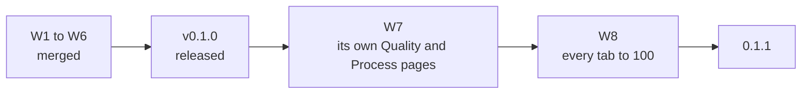

# Website Crafter's first day: 0.1.0 is out, and what comes next   (2026-11-24, no pod, local)

The session that built this repo also ran other work. From here Website Crafter has its own session. Open work is on the
[Website Crafter board](https://github.com/orgs/SoulCraft-Org/projects/6).

**Proven.**

| Thing | State | Source |
|---|---|---|
| Plugin, starters, pack, page tests, tools, guards, README | merged: #6, #8, #10, #12, #14, #16, #18, #19 | `gh pr list --state merged`, 2026-11-24 |
| Release | `v0.1.0` at `1556f98`, immutable releases on | `gh release view v0.1.0` |
| Repo settings | 8 topics, Discussions on, Dependabot security fixes on, milestone 0.1.0 closed | `gh api repos/…`, 2026-11-24 |
| #18's review | blocked once: the export tool followed tracked links, file names were not scanned, the guards missed some deploy and staging commands. All fixed; both self-tests pass on 41 samples | #18, #20 |

**How.** One builder per step, one fresh reviewer per pull request, a verdict comment, then a merge at the reviewed commit.

**Owed.**

| # | Card | Done when |
|---|---|---|
| W7 | This repo's own Quality and Process pages on GitHub Pages, as Git Crafter and Compute Crafter publish theirs | both pages are live |
| W8 | Work its own queue | every tab reads 100 |
| R4 | Issue forms, a pull request template, CODEOWNERS, a release notes file | the community profile reads 100% |
| New | Bring the generic prompting lessons below into the three prompt skills | merged |
| New | An open-weight voice skill (Fish Audio Drama 3) | merged |
| New | Release 0.1.1 | released, on the owner's yes |
| Check | Install the plugin on a clean machine (not done: the build machine already had everything) | `claude plugin install website-crafter@website-crafter` works there |

**Found on the way.** Lessons a public prompt skill can carry:

| Model | Lesson |
|---|---|
| FIBO 2.0 | A group render repeats one face. Draw each person alone, then place them with the edit tool's reference pictures |
| FIBO 2.0 | "Bold exaggerated proportions" suits one hero. In a crowd it draws children |
| FIBO 2.0 | Spell out a hybrid's anatomy: where it joins, and how many of each part |
| LTX-2.5 | Say "static frame, the camera does not move" and replace a template's own negative when it fights the style |
| LTX-2.5 | To loop: crossfade when the last frame matches the first; otherwise play forward then backward |
| LTX-2.5 | To make something form from light, render it dissolving and reverse the clip |
| Any | Say where the character looks. Unsaid, the model picks |

The staging guard blocks `git add -u <path>` although it is scoped. That is strict on purpose.

## Requests

None to other repositories.
