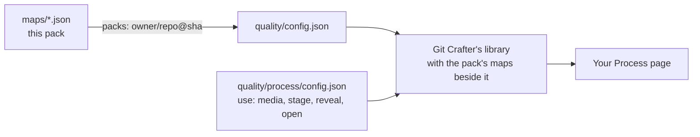

# Process maps

Four Process maps for a website, in the format of Git Crafter's [library maps](https://github.com/SoulCraft-Org/git-crafter/blob/main/pages/maps/README.md). Each step names its tools, a rule and one metric on your Quality page. A site repo adds them as a pack: [pack.json](../pack.json) adds no tab of its own, so every step scores a metric on the six tabs of the [quality starter](../templates/quality/README.md).

| Step | Do |
| --- | --- |
| 1 | In `quality/config.json`, add `"packs": ["SoulCraft-Org/website-crafter@<40-hex sha>"]`, a commit of `main` that holds `maps/`. A tag or a branch is refused, because a pack runs in CI |
| 2 | In `quality/process/config.json`, add `{ "use": "media" }` and the others to `maps` |
| 3 | Push. Git Crafter's `actions/pages` checks the pack out at that commit and draws each map |

| Map | Steps | Reads the tabs | Needs |
| --- | :-: | --- | --- |
| `media` | 5 | `pages`, `pull-requests` | none |
| `stage` | 6 | `pages`, `pull-requests`, `actions` | `wrangler-login` |
| `reveal` | 6 | `pages`, `code` | none |
| `open` | 5 | `pull-requests`, `issues`, `actions` | none |

## Media

Art, video and 3D for a page, from its prompt to a light, steady asset.

| Step | Rule | Metric |
| --- | --- | --- |
| Record | Each asset's pull request records its model, prompt, licence and date in a table. | `pull_requests.body_table_share` |
| Size | Export each image at the widths the page shows, in AVIF or WebP. | `design.total_bytes` |
| Hero first | The hero loads first; every asset below the fold loads lazily. | `design.lcp_mobile` |
| Reserve | Every image, video and canvas has its box before it loads. | `design.cls_mobile` |
| Contrast | Text over art keeps its contrast ratio in both themes. | `design.contrast_violations` |

## Stage

A change to the site, from one build to private previews, a merge and the live page.

| Step | Rule | Metric |
| --- | --- | --- |
| Build once | Build once per change; every later step reads that build. | `ci.latest_pr_dollars` |
| Stage | Stage each changed page as a private preview; keep the change small enough for one sitting. | `pull_requests.over_400_lines` |
| Browser tests | Every page a visitor can open has a browser test that opens it. | `tests.e2e_routes` |
| Review | The owner saw the previews, and the pull request is reviewed at its head. | `pull_requests.reviewed` |
| Merge | Merge within minutes of all green. | `pull_requests.green_to_merge_minutes` |
| Read live | A change is live only when the live page shows it; read it after each deploy. | `deploy.latest_lead_hours` |

## Reveal

A page's first seconds, from first paint to its signature move.

| Step | Rule | Metric |
| --- | --- | --- |
| Role | Say what the page is for first; few words come before its first action. | `usability.words_before_action` |
| First paint | The hero paints first, at the size the page shows it. | `design.lcp_mobile` |
| Start-up budget | Start-up JavaScript stays under the budget; each demo loads by import() near the screen. | `code.client_js_kb` |
| Hold still | Nothing moves the layout once it paints. | `design.cls_mobile` |
| Signature move | The signature move answers input at once; no long task blocks it. | `usability.tbt_mobile` |
| Pause | One Pause motion button stills every animation, loop and video, and a keyboard reaches it. | `usability.axe_violations` |

## Open

A site's code, from a private repo to a public one anyone can fork.

| Step | Rule | Metric |
| --- | --- | --- |
| Export | Every change reaches the public repo by pull request, after the export check. | `pull_requests.commits_via_pr` |
| Intake | Issue forms route each bug and quick fix; the open-repo files say how to help. | `issues.intake_ready` |
| Pin | Every action is pinned to a full commit SHA that Dependabot bumps. | `actions.pinned_share` |
| Answer | Each issue closes by a merged fix or a reply within days. | `issues.latest_close_hours` |
| Cost | A contribution's CI runs on free runners in minutes. | `issues.latest_fix_ci_minutes` |

## Rules every map passes

`tests/pack.test.mjs` runs Git Crafter's own checks at the commit `ci.yml` pins.

| Rule | Checked by |
| --- | --- |
| An ideal of 25 words at most, and dated sources | `checkLibrary` |
| 6 steps at most, each with tools, a rule, an https `rule_ref` and one metric | `checkLibrary`, `MAX_STEPS` |
| A rule of 20 words at most | `checkLibrary` |
| A step of each kind: quality, speed and consumption | `checkLibrary` |
| No id a library map already has | `loadLibrary` |
| Every step a metric on the website quality starter's page | `checkMaps`, in a site repo that pins this pack |
| These tables match the map files | `tests/pack.test.mjs` |
