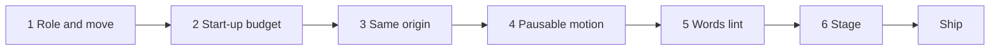

# Craft a site

Six rules, in the order a page meets them. Each one passes or fails in a test, never by eye.

| # | Rule | Passes when |
|---|---|---|
| 1 | Each page has one role and one signature move | The page's one-line role and its move are written down before its layout |
| 2 | A start-up JavaScript budget | A browser test sums the page's start-up scripts under the budget |
| 3 | No third-party requests | A browser test sees every request go to the page's own origin |
| 4 | Motion a pause stills | One button stills every animation, transition, canvas loop and video |
| 5 | A words lint | The lint passes on the built pages, not only the source |
| 6 | Stage before ship | The owner saw each changed page in a private preview before the merge |

## 1. One role, one signature move

A page does one job for one reader. Write its role in one line first: who arrives, and what they leave with. Then pick its signature move, the one thing a visitor remembers. Everything else on the page serves the role and stays quiet. Two moves on one page compete, so give the second its own page.

| Page | Role | Signature move |
|---|---|---|
| Home | A stranger learns what this is | One hero that shows the thing working |
| A product page | A buyer decides | One live demo of that product |
| Pricing | A buyer compares | One comparison table |
| A guide | A reader finishes a task | One example they can copy and run |

## 2. A start-up budget

Start-up JavaScript is every inline script, every script the HTML names, and every module those import statically. A module that a dynamic `import()` loads when its section nears the screen is not start-up code.

| Measure | Goal |
|---|---|
| Start-up JavaScript per page, gzip | 15 KB or less (a goal) |
| Cumulative layout shift | 0.1 or less, web.dev's "good" threshold for Core Web Vitals |

| To stay under | Do |
|---|---|
| Pages | Ship static HTML and CSS first; add a script only for the signature move |
| Demos | Load each one by `import()` when an `IntersectionObserver` sees it near the screen |
| Layout | Give every image, video and canvas its box up front: `width` and `height`, or `aspect-ratio` |

## 3. No third-party requests

Every request a page makes goes to its own origin. Self-host fonts, images and video. Reach a payment or sign-in provider by a link, never an embed. A page then leaks nothing about its readers, loads faster, and keeps working when another host is down. The test may allow a host by name, such as your host's own analytics, each with its reason beside it.

## 4. Motion a pause stills

WCAG 2.2 success criterion 2.2.2 asks that motion which starts by itself and lasts over five seconds can be paused.

| Part | How |
|---|---|
| The button | One site-wide button, always labelled "Pause motion". Its state lives in `aria-pressed`, never in a changing label |
| The switch | It sets `data-motion="paused"` on `<html>` |
| CSS | `[data-motion="paused"] *` stills every animation and transition |
| Scripts | Each canvas loop and video watches the attribute and stops |
| Memory | The choice is kept in `localStorage`, inside `try`, and a head script applies it before first paint |
| Default | `prefers-reduced-motion: reduce` starts the site paused |

## 5. A words lint

The rules live in one data file: the words a page must never say, and the shapes that give a draft away. The lint reads the built HTML, so text a template generates is caught too. Block on the certain, such as an em dash, placeholder text or a banned name. Warn on the likely, such as a long sentence or a figure with no source beside it.

## 6. Stage before ship

| Step | Do |
|---|---|
| Build | Build the site once |
| Stage | Publish each changed page as a private preview the owner can open, such as a claude.ai artifact or the host's preview URL |
| Review | The owner reads the previews and asks for changes |
| Ship | Commit by path, open a pull request, and let CI run the browser tests. The merge deploys |
| Check | Read the live page. A change is live only when the live page shows it |

## Before a page is done

| Check | Done |
|---|---|
| Its role and signature move are written down | [ ] |
| The budget test passes | [ ] |
| The same-origin test passes | [ ] |
| Pause motion stills everything on it | [ ] |
| The words lint passes on the built page | [ ] |
| The owner saw it staged | [ ] |
