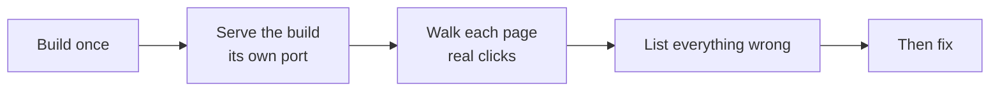

# Preview the site

A preview is the built site, served the way production serves it, and read by a person's eye. Tests say a rule holds; a preview shows what a visitor sees.

| Step | Do |
| --- | --- |
| Build | Run the site's own build, once. Fix a failed build before anything else |
| Serve | Serve the build, not a dev server: the build is what ships. Give it an explicit port and refuse a busy one (`--strictPort` or its equivalent) |
| Walk | Open each page in [page roles](https://github.com/SoulCraft-Org/website-crafter/blob/main/templates/page-roles.md). Click what a visitor clicks, scroll to the end, and take a screenshot |
| Widths | Every page at a desktop width (1280) and a phone width (390) |
| Themes | Light and dark, when the site has both |
| List | Write the whole list of what looks wrong before you change anything: copy, order, contrast, overlap, a page that misses its role |
| Stop | Stop the server you started. Leave no process running |

## Rules

| Rule | Why |
| --- | --- |
| Never call a page's handler from a script to skip a flow | It passes with the page broken; click the real button instead |
| Read each page against its role and its signature move | The craft-site skill's rule 1: one job, one move |
| A screenshot is evidence, not a verdict | Say what you saw on which page and at which width |
| Where your rules keep browsers off this machine, walk the pages in CI or a cloud session | Your compute rules say where a browser runs |

After the list, use the `stage` skill to show the owner the pages.
