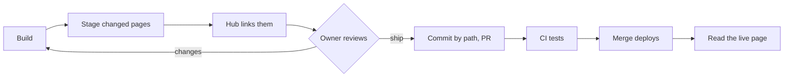

# Stage, then ship

The craft-site skill's rule 6. The owner sees each changed page before the merge, in a preview that stays at one link across rounds.

## Stage

| Step | Do |
| --- | --- |
| 1 Build | Build the site once |
| 2 Prepare | Copy each page into its own folder, rewritten to stand alone (the table below) |
| 3 Compare | Hash each prepared page and compare it with the manifest; only pages whose hash changed are published |
| 4 Publish | Publish each changed page to its own preview. A page that has a preview already is updated at its link, never published anew |
| 5 Record | Store each page's link and hash in the manifest, and commit the manifest with the change |
| 6 Hub | Publish one hub page that lists every page and links its preview. Send the owner the hub's link |

The manifest, such as `stage/artifacts.json`, maps each page to `{ "url", "title", "path", "sha256" }`, plus the hub's link. It is what keeps the owner's links working from one round to the next.

## What a claude.ai artifact needs

A site that staged every page as an artifact found these (2026-11).

| Need | Because |
| --- | --- |
| Asset URLs relative to the page | The artifact serves the page under a path of its own, so a root-relative `/assets/x.js` misses |
| No published path that starts with `_` | The artifact service refuses those names; publish a build folder like `_astro/` as `assets/` and rewrite the URLs |
| `target="_top"` on links between pages | Without it a link opens inside the artifact's frame |
| The page's `<title>` within its first 8 KB | The artifact takes its name from there |
| The page's base styles, restated after the frame's | The wrapper sets a light theme and a system font that beat layered CSS. Without them dark mode breaks |
| A hash that leaves out the staging banner | Otherwise a new commit alone republishes every page |

A host's preview URL, such as a pull request's preview deploy, needs none of this. Use it for flows an artifact cannot run: checkout, sign-in, anything that calls the site's server.

## Ship

| Step | Do |
| --- | --- |
| Commit | Stage files by path, never every file at once. The manifest goes in the same commit |
| Pull request | Use the [pull request template](https://github.com/SoulCraft-Org/website-crafter/blob/main/templates/pull-request.md): the page's role, its signature move, the preview links and the art record |
| CI | The page tests run: budget, origin, words and motion |
| Merge | The merge deploys. Merge only what should go live |
| Read live | Open the live page and look for the change. A change is live only when the live page shows it |

A deploy, a remote write and a payment change each wait for the owner's yes.
