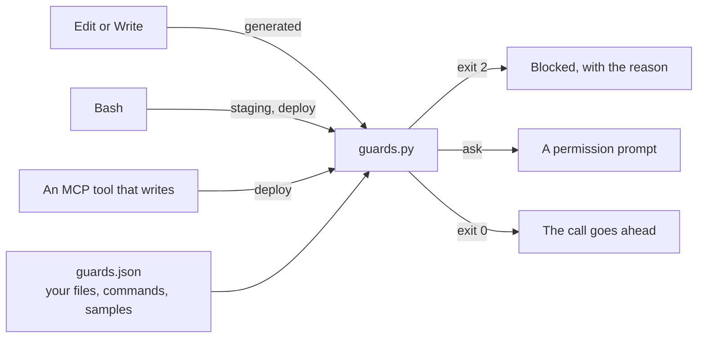

# Guard hooks

Three Claude Code hooks for a site repo. They keep hand edits off generated files, keep staging by path, and turn every deploy into a question for the owner. One Python file holds every rule; each hook only routes a tool call to it.

| Step | Do |
| --- | --- |
| 1 | Copy `guards.py` and `guards.json` to `<your site>/.claude/hooks/` |
| 2 | Merge the `hooks` block of `settings.json` into `<your site>/.claude/settings.json` |
| 3 | Edit `guards.json`: your generated files, your deploy commands and tools, and a sample for each rule |
| 4 | Run `python3 .claude/hooks/guards.py --self-test` in CI. It fails when a sample is judged wrong, or a rule has no sample |

| Guard | Fires on | Does | Rules from |
| --- | --- | --- | --- |
| `generated` | Every Edit and Write | Blocks an edit to a file a tool writes, and names that tool | `guards.json` `generated` |
| `staging` | Every Bash call | Blocks a whole-tree `git add` or `git stage` (`-A`, `-u`, `.`, `./`, `*`, `:/`), `git commit -a`, and `--amend` with no pathspec | Built in: `add-all`, `commit-all`, `amend` |
| `deploy` | Every Bash call, and the MCP tools the matcher names | Asks the owner before a deploy, rollback, remote write or secret change | `guards.json` `deploy` and `tools` |

| Limit | So |
| --- | --- |
| `generated` sees only Edit and Write | A Bash `sed -i`, a `>` redirect or a script that writes a generated file passes. CI's check that the file matches its generator is the backstop |
| `staging` and `deploy` read the command as typed | They do not follow `sh -c`, `bash -c`, `eval`, a shell alias or a script. Name a script that deploys in `guards.json` |

| File | Holds |
| --- | --- |
| `guards.py` | The three guards and the self-test. It matches text and never runs a command |
| `guards.json` | Your site's data, and a known-good and a known-bad sample for each rule |
| `settings.json` | The `hooks` block that wires each guard to its tool calls |

A guard that cannot read its input exits 1: Claude Code shows a hook error and lets the call through, because could not check is not a finding. These hooks fire on each call; nothing here waits for a slash command.
