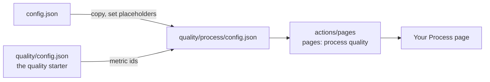

# Process starter for a website

Your site's Process page: three maps from Git Crafter's library, each step scored by a metric on your Quality page. [config.json](config.json) is the Process config and its maps file in one. It is Git Crafter's [process starter](https://github.com/SoulCraft-Org/git-crafter/blob/main/templates/process/README.md) cut to the maps a site repo can score.

| Step | Do |
| --- | --- |
| 1 | Set up the [quality starter](../quality/README.md) first: every step here reads one of its tabs |
| 2 | Copy `config.json` to `<your repo>/quality/process/config.json` |
| 3 | Replace the placeholders below |
| 4 | Push. Git Crafter's `pages.yml` draws the page with `pages: process quality` |

## Placeholders

| Placeholder | Where | Set it to |
| --- | --- | --- |
| `my-site` | `repos`, `heading` | your repo's name, with no owner |
| `OWNER`, `my-site` | `repo_url` | your GitHub owner and repo name |

## Maps

| Map | Steps | Reads the tabs | Needs |
| --- | :-: | --- | --- |
| `delivery` | 5 | `pull-requests` | none |
| `deploy` | 4 | `pages` | `wrangler-login`, or `platform: "pages"` |
| `code` | 6 | `code`, `actions` | none |

Git Crafter's other library maps read tabs this starter's Quality config leaves out, so their steps would fail the build. Add one with `{ "use": "<id>" }` once its tab is on ([pages/maps](https://github.com/SoulCraft-Org/git-crafter/blob/main/pages/maps/README.md)).

## Keys

| Key | Set it to |
| --- | --- |
| `repos` | the repo the page reads; the first is its own |
| `repo_url` | `https://github.com/<owner>/<repo>/blob/main`, where each rule link points |
| `docs` | `maps` names this file: it is the maps file too |
| `quality_config` | the Quality config whose metric ids the maps use |
| `maps` | `{ "use": "<id>" }` per map |
| `data`, `history`, `out` | the collector's file, `null` for no history, and the folder the pages build into |
| `pages`, `tabs` | the Process page's file name, and its tabs: `build` (titled "Maps"), `ci`, `testing` |
| `heading`, `collector`, `nav` | the title on every page, the footer's name for the data's writer, and the links on every page |
