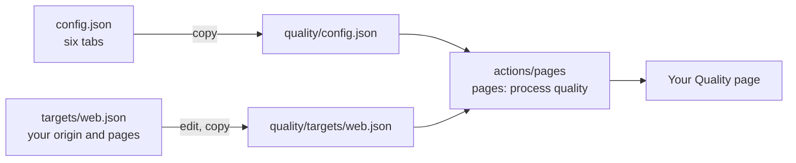

# Quality starter for a website

Your site's Quality, Speed and Consumption page, built by Git Crafter's `actions/pages` from two files you own. It is Git Crafter's [quality starter](https://github.com/SoulCraft-Org/git-crafter/blob/main/templates/quality/README.md) cut to the six tabs a site repo can measure in CI.

| Step | Do |
| --- | --- |
| 1 | Copy `config.json` to `<your repo>/quality/config.json` and set `name` to your site's name |
| 2 | Edit `targets/web.json`: your production `origin`, one `key_pages` path per page role, your `src_dirs`. Copy it to `<your repo>/quality/targets/web.json` |
| 3 | Copy Git Crafter's [pages.yml](https://github.com/SoulCraft-Org/git-crafter/blob/main/templates/ci/pages.yml) and the [process starter](../process/README.md). A push to main builds both pages |
| Pack | `packs` pins Website Crafter's pack at a full commit SHA: it adds the four Process maps and no tab. To move it, paste a newer `main` commit's full SHA. For a local run, clone the pack at that SHA into `.code-os-packs/SoulCraft-Org/website-crafter` and gitignore `.code-os-packs/` |

## The six tabs

A metric whose token is missing reads not measured, never 0, so every tab here is safe to keep.

| Tab | Measures for a site | Needs |
| --- | --- | --- |
| `pages` | Deploys, design tokens, contrast, Core Web Vitals, axe, reading grade, task clicks | `wrangler-login`, or `platform: "pages"` |
| `code` | Size, complexity, copies, dead code, test coverage | `github-admin`, `cloudflare` |
| `pull-requests` | Size, review at head, wait after green | none |
| `actions` | CI speed, red time, runner cost, tests, the pages no browser test opens | `github-admin` |
| `issues` | Bugs and quick fixes, forms, labels, time to close | none |
| `dependabot` | Alerts, updates, dependencies and actions current | `github-admin`, `vulnerability-alerts` |

| Left out | Why | Add it back |
| --- | --- | --- |
| `documentation` | Its `docs.unmapped` gate fails a pull request until every doc is on a map | Add the id once your docs are mapped |
| `discussions`, `projects`, `security`, `scanning`, `insights`, `settings` | Each reads an admin token or a project board that CI does not hold | Add the id with that token |

## targets/web.json

| Entry | Sets |
| --- | --- |
| `design.raw_hex` | The site the Pages tab reads: `origin` or `site_dir`, `key_pages`, `src_dirs`, `tokens` |
| `usability.reading_grade` | The same site for the usability metrics, and `crawl_skip` for paths that are not pages |
| `deploy.waiting_merges` | `platform: "pages"` for GitHub Pages; a Worker sets `worker_dir` instead |
| `tests.e2e_routes` | Where the unit and browser tests live, and where each page's source lives |

Each entry's `comment` says what to change. Git Crafter merges these params key by key over its own ([CONFIG.md](https://github.com/SoulCraft-Org/git-crafter/blob/main/quality/CONFIG.md)).
