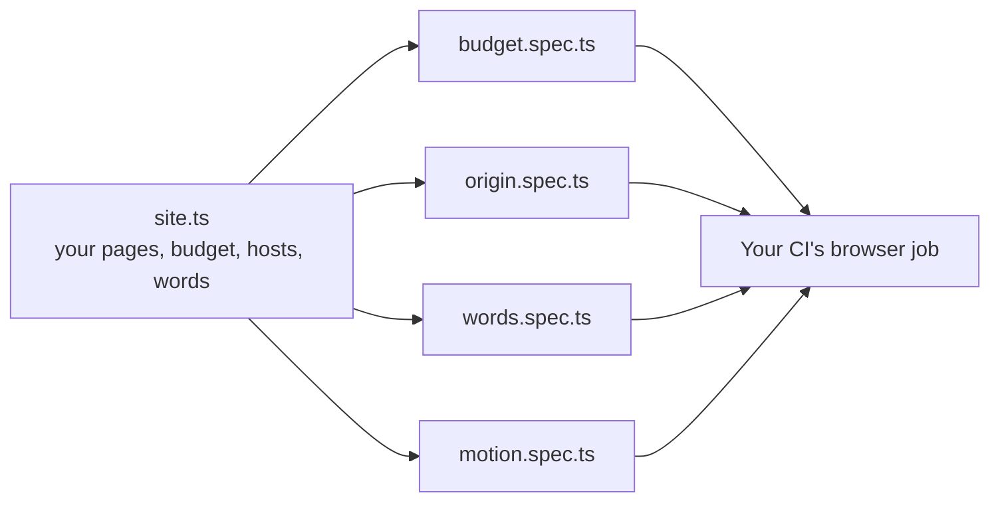

# Page tests

Four Playwright tests, one for each rule of the [craft-site skill](../../plugin/skills/craft-site/SKILL.md) a browser can check. Each opens every page in `site.ts` the way a visitor does. They come from the tests a live site runs in CI.

| Step | Do |
| --- | --- |
| 1 | Copy this folder to `<your site>/tests/e2e/`, and add `@playwright/test` to your dev dependencies |
| 2 | Edit `site.ts`: your pages, and any host your pages may reach |
| 3 | Run them in CI against a preview of the built site, with your Playwright config's `baseURL` set to it. Never on a laptop that only edits |

| File | Checks | Rule |
| --- | --- | --- |
| `site.ts` | Nothing: the values the four specs read | |
| `budget.spec.ts` | Layout shift of 0.1 or less, and start-up JavaScript under the budget, gzip | 2 |
| `origin.spec.ts` | Every request goes to the page's own origin, or a host `site.ts` allows | 3 |
| `motion.spec.ts` | One Pause motion button stills every animation, video and animation frame; the choice survives a reload; reduced motion starts still | 4 |
| `words.spec.ts` | No dash, placeholder, unfilled value or banned word in what a visitor reads; long sentences warn | 5 |

| Value in `site.ts` | Default | Set it to |
| --- | --- | --- |
| `PAGES` | `/` | every page a visitor can open; `SITE_PAGES` in CI |
| `START_UP_JS_BYTES` | 15 KB, a goal | your budget; `SITE_JS_BUDGET` in CI |
| `MAX_CLS` | 0.1, web.dev's "good" threshold | keep it |
| `ALLOWED_HOSTS` | none | a host and its reason, only when it earns its place |
| `PAUSE_LABEL` | Pause motion | your button's name, which never changes |
| `WORDS` | dashes, placeholders, unfilled values | add your site's banned words |

This repo runs all four against a tiny fixture site in CI: on `tests/fixture/good` every test passes, and on `tests/fixture/bad` every test fails.
